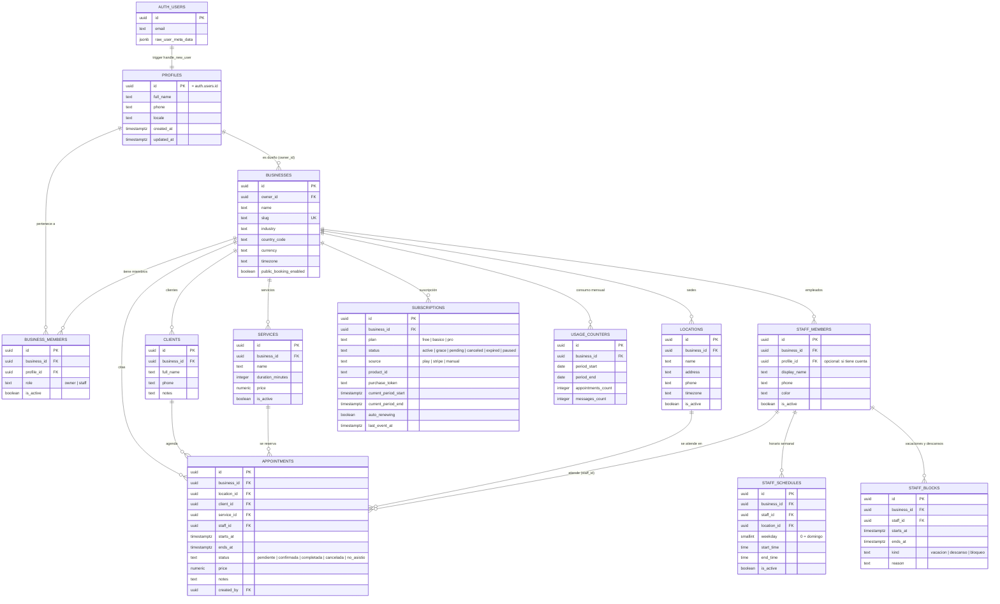

# Modelo de datos y RLS

## Diagrama de tablas

## Funciones auxiliares (SECURITY DEFINER)

| Función | Uso |
| ------- | --- |
| `is_business_member(business_id)` | El usuario es miembro activo del negocio. |
| `is_business_owner(business_id)` | El usuario es el dueño (`businesses.owner_id`). |
| `has_business_role(business_id, roles[])` | Comprueba el rol `owner`/`staff`. |
| `shares_business_with(profile_id)` | Dos perfiles comparten algún negocio. |

Son `SECURITY DEFINER` para que las políticas puedan consultar
`business_members` sin recursión infinita.

## Políticas por tabla

| Tabla | SELECT | INSERT | UPDATE | DELETE |
| ----- | ------ | ------ | ------ | ------ |
| `profiles` | propio perfil o compañeros de negocio | solo el propio id | solo el propio perfil | — |
| `businesses` | miembros | `owner_id = auth.uid()` | dueño | dueño |
| `business_members` | miembros | dueño (el owner inicial lo crea un trigger) | dueño | dueño (no puede borrar al owner) |
| `locations` | miembros | dueño | dueño | dueño |
| `staff_members` | miembros | dueño | dueño | dueño |
| `staff_schedules` | miembros | dueño | dueño | dueño |
| `staff_blocks` | miembros | dueño y empleados | dueño y empleados | dueño y empleados |
| `services` | miembros | dueño y empleados | dueño y empleados | dueño y empleados |
| `clients` | miembros | dueño y empleados | dueño y empleados | dueño y empleados |
| `appointments` | miembros | dueño y empleados | dueño y empleados | dueño y empleados |
| `subscriptions` | miembros | ❌ (solo service role) | ❌ (solo service role) | ❌ |
| `usage_counters` | miembros | ❌ (solo service role) | ❌ (solo service role) | ❌ |

`subscriptions` y `usage_counters` son de solo lectura para la app: los escribe
el backend con la `service_role` key al verificar compras de Play y al correr
las tareas programadas.

## Triggers

| Trigger | Tabla | Efecto |
| ------- | ----- | ------ |
| `on_auth_user_created` | `auth.users` | Crea el registro en `profiles` al registrarse. |
| `on_business_created` | `businesses` | Agrega al dueño como miembro `owner`. |
| `validate_appointment_consistency` | `appointments` | Cliente, servicio, sede y empleado deben ser del mismo negocio. |
| `validate_appointment_no_overlap` | `appointments` | Impide dos citas activas del mismo empleado en horarios que se solapan. |
| `validate_staff_child_consistency` | `staff_schedules`, `staff_blocks` | El empleado debe pertenecer al negocio. |
| `set_updated_at` | todas | Mantiene `updated_at`. |

Estados `cancelada` y `no_asistio` liberan el horario: la verificación de choques
solo considera `pendiente`, `confirmada` y `completada`.

## Índices relevantes

- `appointments (business_id, starts_at)`: agenda del día y de la semana.
- `appointments (staff_id, starts_at)`: validación de choques de horario.
- `clients (business_id, phone)` y `clients (business_id, lower(full_name))`: búsqueda.
- `subscriptions (business_id, current_period_end)`: plan vigente.
- `subscriptions_purchase_token_key`: un `purchase_token` pertenece a un solo negocio.

## Pruebas de aislamiento

`backend/tests/rls/test_isolation.py` crea dos negocios con un dueño cada uno más
un empleado y verifica que:

- un dueño solo ve su negocio, clientes, citas, suscripciones y contadores;
- un empleado ve la agenda de su negocio y no puede editar el negocio;
- no se puede insertar una cita en un negocio ajeno (RLS) ni mezclar datos de dos
  negocios (trigger de consistencia);
- la app no puede escribir en `subscriptions`.
